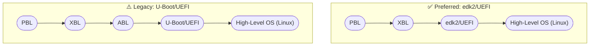

# qcom-ptool

`qcom-ptool` contains various device partitioning utilities like `ptool.py`, `gen_partitions.py` and various sample partition configuration files needed for Qualcomm SoCs. Qualcomm Linux currently could be build for the follow reference Linux based OSes:

- Yocto with [meta-qcom](https://github.com/qualcomm-linux/meta-qcom)
- debos Debian based with [qcom-deb-images](https://github.com/qualcomm-linux/qcom-deb-images)
- Gaia DeimOS Debian based with [cookbook-qcom](https://github.com/gaiaBuildSystem/cookbook-qcom)

These references use `qcom-ptool` to generate partition table layouts. The partition GUIDs, names and size budgets are picked to support boot flows as follows:



# Installation

The project is packaged as a standard Python distribution and installs a
single `qcom-ptool` command with subcommands for each utility:

```sh
pip install .
```

Once installed, the tool is invoked as:

```sh
qcom-ptool gen_partition -i platforms/<soc>/<variant>/partitions.conf -o partitions.xml
qcom-ptool gen_contents  -p partitions.xml -t contents.xml.in -o contents.xml
qcom-ptool gen_udev_rules -o 55-qcom-raw-partitions-noblkid.rules
qcom-ptool ptool         -x partitions.xml
qcom-ptool msp           -r rawprogram0.xml -d /dev/sdX -p patch0.xml
```

By default, the generator scans all `platforms/*/*/partitions.conf` files.
Repeatable `-i` options can select specific layouts. It skips known filesystem
partition names and emits exact `PARTNAME` rules for the others. Unknown names
retain normal blkid probing. The rules use
`UDEV_DISABLE_PERSISTENT_STORAGE_BLKID_FLAG` on systemd v252 and newer.

Run `qcom-ptool <subcommand> -h` to see the options accepted by each
subcommand.

# Development

## Dependencies

At runtime the tool targets Python 3.8+ and depends on two third-party
libraries, `PyYAML` and `jsonschema`, used to load and validate the YAML
partition source. Both are declared in `pyproject.toml` and pulled in
automatically by `pip install .`.

For development, `make lint` invokes `ruff` and `mypy` and `make unit-test`
runs the `pytest` suite under `tests/unit/`. On Debian/Ubuntu, install
them as follows (ruff is not packaged in apt on all releases/architectures,
so we install it from snap):

```sh
sudo snap install ruff
sudo apt install mypy python3-pytest
```

## Makefile targets

| Target        | Description                                                |
|---------------|------------------------------------------------------------|
| `all`         | Generate partition XML and GPT binaries for all platforms  |
| `lint`        | Run ruff (linter) and mypy (type checker) on the package   |
| `unit-test`   | Run the pytest suite under `tests/unit/`                   |
| `integration` | Build all platforms and verify generated files are present |
| `check`       | Run `lint`, `unit-test`, and `integration`                 |
| `install`     | Install the package (`pip install .`)                      |
| `clean`       | Remove generated XML and binary files from platforms/      |

The Makefile invokes `qcom-ptool` from `PATH`. Install the package (or
`pip install -e .` from the repo root) before running `make all`.

### Quick start

```sh
# install the tool
pip install -e .

# install linters and test runner (Debian/Ubuntu)
sudo snap install ruff
sudo apt install mypy python3-pytest

# run linters and unit tests
make lint
make unit-test

# build all platforms and run tests
make check
```

## Code contributions

See [CONTRIBUTING.md file](CONTRIBUTING.md) for instructions on how to send
code contributions to this project. You can also [report an issue on
GitHub](../../issues).

# Maintainer(s)

See [CODEOWNERS](.github/CODEOWNERS).

# License

This project is licensed under the [BSD-3-clause
License](https://spdx.org/licenses/BSD-3-Clause.html). See
[LICENSE](LICENSE) for the full license text.
